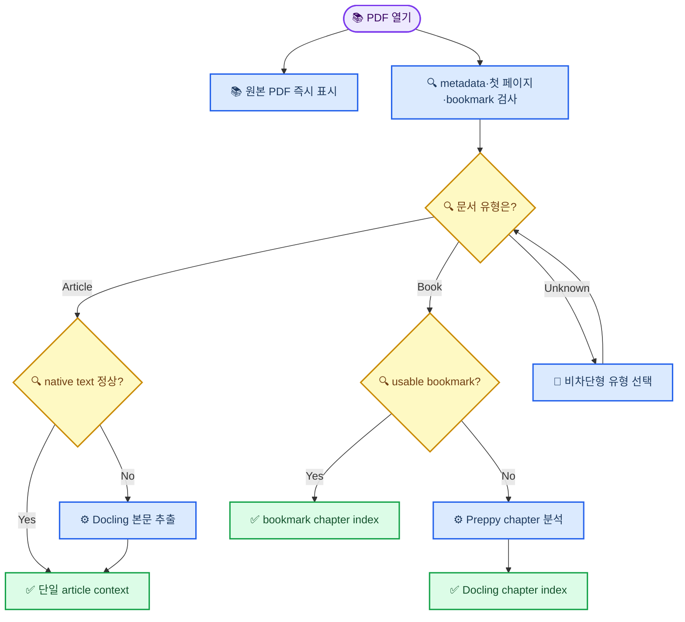
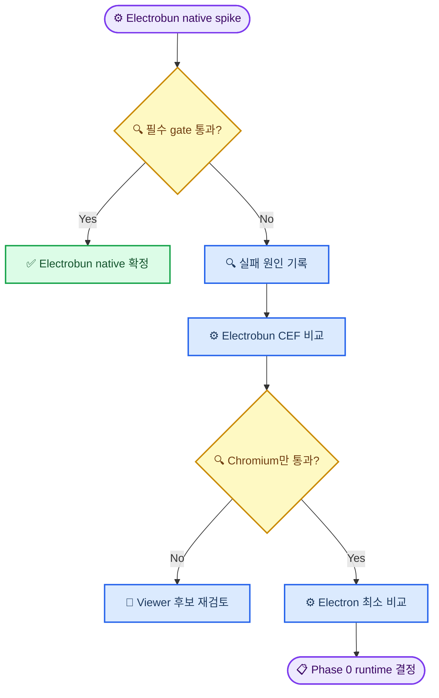

# PDFie product requirements document

_PDF 전용 학술 읽기 앱의 제품·UX·기술 경계를 정의하는 구현 계약 — 2026-08-04_

---

## 📋 문서 계약

이 문서는 PDFie의 제품 요구사항에 대한 최상위 기준이다. 구현자는 기능을 추가하기 전에 이 문서와 `implementation_plan.md`를 모두 읽어야 한다.

우선순위가 충돌하면 다음 순서를 따른다.

1. 사용자가 대화에서 명시한 최신 요구사항
2. 이 `PRD.md`
3. `implementation_plan.md`
4. 기존 MD Reader와 Preppy의 현재 구현
5. 라이브러리 예제와 구현자의 개인적 판단

이 문서에 없는 큰 제품 결정은 임의로 확정하지 않는다. 그러나 오류 처리, 테스트 보강, 타입 안정성처럼 제품 의미를 바꾸지 않는 구현 세부사항은 합리적으로 결정한다.

### 현재 프로젝트 상태

- PDFie 작업 디렉터리는 아직 애플리케이션 코드와 Git 저장소가 없는 신규 프로젝트다.
- UI와 AI sidebar의 사용자 경험 기준 구현은 `/Volumes/Aquatope/_DEV_/MD_Reader`다. 이 저장소의 React UI와 제품 동작은 재사용하지만 Electron shell, preload와 IPC 구현은 그대로 복사하지 않는다.
- PDF 의미 구조와 fallback 변환의 기준 구현은 `/Volumes/Aquatope/_DEV_/Preppy`다.
- Electrobun app shell과 self-contained Python worker packaging의 기준 구현은 `/Volumes/Aquatope/_DEV_/Interactive_Learning`이다.
- Electrobun에서 PDF worker와 bundled CLI를 찾는 기준 구현은 `/Volumes/Aquatope/_DEV_/PDF_to_MD/pdf-to-md`다.
- 모든 기준 저장소는 읽기 전용 참조 대상으로 취급한다. PDFie 작업 중 해당 저장소를 수정하지 않는다.

## 🎯 제품 요약

PDFie는 논문과 단행본을 집중해서 읽으면서 선택한 문장과 현재 읽기 범위를 AI에게 질문할 수 있는 데스크톱 PDF reader다. MD Reader의 AI sidebar, provider 설정, streaming 응답, 대화 저장, memory 및 web research 경험을 재사용하되 문서 surface와 context 조립은 PDF 전용으로 다시 설계한다.

제품이 해결해야 하는 핵심 문제는 세 가지다.

1. 기존 React-PDF 기반 reader에서 정확하지 않았던 text selection
2. 논문과 책을 동일한 chapter 처리에 넣을 때 생기는 불필요한 분석과 잘못된 context
3. 긴 책 전체 또는 긴 chapter 전체를 무조건 prompt에 넣을 때 생기는 비용·속도·정확도 저하

### 제품 가치

- 사용자는 원본 PDF를 그대로 읽는다.
- 선택한 텍스트가 보이는 순서와 AI에 전달되는 순서가 일치한다.
- 논문은 하나의 연구 문서로, 책은 semantic chapter들의 집합으로 취급한다.
- bookmark가 좋은 책은 Docling 없이 즉시 구조화한다.
- Docling은 필요한 PDF에만 실행하는 fallback이자 enrichment 도구다.

## 👤 대상 사용자와 사용 맥락

### 주요 사용자

- 학술 논문을 읽으며 주장, 방법, 결과, 표와 그림을 질문하는 연구자
- 전공 단행본을 장시간 읽으며 현재 chapter를 중심으로 AI와 대화하는 독자
- 영어 및 한국어 PDF를 오가며 정확한 인용 위치와 원문 보존을 중시하는 사용자

### 사용자의 상태

사용자는 문서 자체에 집중하고 있다. 앱은 분석 pipeline과 기술 용어를 전면에 내세우지 않고, 읽기를 방해하지 않으면서 필요한 순간에 현재 context가 무엇인지 설명할 수 있어야 한다.

### 핵심 사용자 작업

1. PDF를 열고 즉시 첫 페이지를 읽는다.
2. 페이지를 이동하거나 bookmark로 chapter를 찾는다.
3. 한 문장 또는 여러 문단을 정확하게 선택한다.
4. 선택 내용을 AI sidebar로 보내 설명, 요약, 비판 또는 질문을 요청한다.
5. 앱을 다시 실행했을 때 읽던 페이지와 대화를 이어간다.

## 📚 목표와 비목표

### MVP 목표

- macOS 14 이상을 대상으로 하는 Electrobun desktop app으로 로컬 PDF를 연다.
- 기본 renderer는 CEF를 포함하지 않은 macOS native WebKit이며, Phase 0 acceptance gate를 통과한 경우에만 이 runtime 결정을 확정한다.
- text selection, copy, search, zoom, rotation, page navigation, thumbnail을 제공한다.
- 선택 결과에 `text`, `pageNumber`, `rects/bbox`가 포함된다.
- PDF를 먼저 `article`, `book`, `unknown`으로 빠르게 분류한다.
- article은 chapter 분할을 생략한다.
- book은 usable bookmark를 우선 사용하고, 없거나 불량할 때만 Preppy/Docling을 사용한다.
- MD Reader와 동일한 AI sidebar 기능과 설정을 재사용한다.
- article chat은 문서 단위, book chat은 semantic chapter 단위로 저장한다.
- 읽기 위치, 문서 유형 override, 분석 cache와 chat session이 재시작 후 복구된다.
- 원본 PDF를 수정하지 않는다.

### MVP 비목표

- PDF 텍스트나 페이지 자체 편집
- PDF 합치기, 분할, 서명 또는 form 작성
- 클라우드 문서 동기화와 공동 편집
- Zotero library 관리
- 영구 highlight·note annotation의 완성형 구현
- 모든 PDF에서 완벽한 OCR 또는 표 복원 보장
- 온라인 DOI/Crossref metadata enrichment
- 임의의 PDF를 학술 논문으로 단정하는 완전자동 분류

영구 annotation은 selection locator가 안정적이라는 것이 검증된 후 후속 범위로 추가한다. MVP에서 locator를 버리지 않는 이유는 이 후속 기능과 AI 답변의 page citation에 재사용하기 위해서다.

## 💡 제품 원칙

1. **읽기 우선:** PDF 렌더링은 분류와 Docling 완료를 기다리지 않는다.
2. **의미와 형식 분리:** `sourceKind = pdf`와 `documentType = article | book | unknown`을 별도 상태로 둔다.
3. **가벼운 경로 우선:** native text와 bookmark가 충분하면 Python/Docling을 실행하지 않는다.
4. **선택 내용 우선:** AI context에서 사용자가 직접 선택한 텍스트가 가장 높은 우선순위를 갖는다.
5. **근거 위치 보존:** AI로 전달하는 모든 PDF text에는 가능한 한 page와 bbox provenance를 붙인다.
6. **사용자 판단 우선:** 자동 분류는 설명 가능하고 언제든 사용자가 수정할 수 있어야 한다.
7. **원본 불변:** viewer, cache, AI context가 원본 PDF를 변경하지 않는다.
8. **재시작 안전:** 읽기와 대화 상태는 앱 종료 후에도 유지된다.
9. **Native renderer 우선:** macOS native WebKit을 기본으로 사용하되 핵심 selection과 packaged worker가 통과하지 않으면 기술 선호보다 검증 결과를 우선한다.

## ⚙️ 제품 구조



### 시스템 구성요소

| 구성요소 | 책임 | 실행 위치 |
| --- | --- | --- |
| PDF viewer adapter | 렌더링, 선택, page, search, bookmark | Electrobun main view |
| PDF document store | 탭과 활성 문서의 UI 상태 | Electrobun main view |
| Fast classifier | article/book/unknown 판별 | Shared pure logic |
| Analysis service | hash, cache, worker, 상태 조정 | Electrobun Bun process |
| Preppy worker | Docling fallback과 enrichment | Child process |
| Context assembler | 선택·페이지·chapter chunk 조립 | Bun/shared boundary |
| AI sidebar | 질문, streaming, session, memory | MD Reader React UI 이식 |
| Persistence | 설정, 읽기 상태, chat, 분석 cache | Electrobun Bun process |

### Desktop runtime decision

PDFie의 기본 runtime은 Electrobun이며 `bundleCEF: false`, native renderer를 사용한다. Electrobun은 bundled asset을 `views://`로 제공하고 선택적으로 CEF를 포함할 수 있으므로, viewer와 WASM asset은 이 경계에서 검증한다.[^1] CEF는 기본 의존성이 아니라 native WebKit 실패 원인을 분리하기 위한 비교 수단이다.



Phase 0에서 native WebKit이 필수 gate를 통과하면 이후 phase에서 Electron으로 되돌아가지 않는다. 반대로 EmbedPDF가 native WebKit에서만 실패하고 CEF에서 통과한다면, CEF를 자동 채택하지 않고 Electron의 Chromium 일관성, MD Reader main-process 재사용 범위, package 크기와 유지보수 비용을 같은 fixture로 비교한다. runtime 결정은 `docs/decisions/000-desktop-runtime.md`에 남기고 Phase 1 전에 끝낸다. Electrobun native 이외의 runtime이 선택되면 이후 구현을 시작하기 전에 이 PRD와 `implementation_plan.md`를 새 결정에 맞게 갱신한다.

## 📋 문서 도메인 모델

### 최상위 상태

```ts
type SourceKind = 'pdf'
type DocumentType = 'article' | 'book' | 'unknown'
type DocumentTypeSource = 'auto' | 'user'
type ExtractionMode = 'native' | 'docling' | 'ocr'
type StructureMode =
  | 'article-single-document'
  | 'bookmark-chapters'
  | 'docling-chapters'
  | 'unknown-document'

interface PdfDocumentRecord {
  documentHash: string
  filePath: string
  fileName: string
  pageCount: number
  sourceKind: 'pdf'
  documentType: DocumentType
  documentTypeConfidence: number
  documentTypeSource: DocumentTypeSource
  extractionMode: ExtractionMode
  structureMode: StructureMode
  currentPage: number
  zoom: number
  rotation: number
  analysisVersion: number
}
```

### Selection locator

```ts
interface PdfSelection {
  text: string
  normalizedText: string
  pages: Array<{
    pageNumber: number
    rects: Array<{ x: number; y: number; width: number; height: number }>
  }>
  source: 'viewer'
}
```

좌표는 viewer scale에 종속된 CSS pixel이 아니라 PDF page coordinate로 정규화해 저장한다. 원본 선택 텍스트와 검색용 정규화 텍스트를 모두 보존한다. AI에 인용할 때 원본 텍스트를 사용한다.

### Semantic unit과 chunk

```ts
interface PdfSemanticUnit {
  id: string
  kind: 'article' | 'chapter' | 'section'
  title: string
  parentTitle: string | null
  pageStart: number
  pageEnd: number
  source: 'article' | 'bookmark' | 'docling'
}

interface PdfTextChunk {
  id: string
  semanticUnitId: string
  text: string
  pageStart: number
  pageEnd: number
  locators: PdfSelection['pages']
  headingPath: string[]
  tokenCount: number
}
```

`pdf_item_index` 같은 변환 내부 index는 영구 ID로 사용하지 않는다. 안정적인 ID는 `documentHash`, semantic unit ID, page 범위, 정규화 text hash로 만든다.

## 🔍 문서 유형 판별

### 중요한 차이

MD Reader의 Markdown/EPUB 구분은 확장자로 확정할 수 있지만 PDF의 article/book 구분은 의미 추정이다. 따라서 자동 결과에는 항상 confidence와 evidence를 저장하고, 사용자가 바꾼 결과를 같은 SHA-256 문서에 영구 적용한다.

### Fast facts

Docling을 실행하기 전에 다음 값만 수집한다.

- page count와 native PDF metadata
- bookmark/outline tree와 내부 destination page
- 첫 3페이지의 native text
- 마지막 20%에서 최대 3페이지의 native text
- native text item 수와 printable-character 비율
- 암호화, text permission, image-only 가능성

### 초기 scoring contract

점수는 deterministic하게 계산하고 evidence 목록을 함께 반환한다. page count 단독으로 분류해서는 안 된다.

| 신호 | Article 점수 | Book 점수 |
| --- | ---: | ---: |
| 첫 3페이지의 DOI | +4 | 0 |
| Abstract와 scholarly author/affiliation 구조 | +4 | 0 |
| journal·conference metadata | +3 | 0 |
| 후반부 References heading | +2 | 0 |
| ISBN metadata 또는 본문 패턴 | 0 | +4 |
| 3개 이상의 semantic chapter bookmark | 0 | +5 |
| Part/Book/Volume 아래 Chapter 구조 | 0 | +4 |
| Preface/Contents/Index 조합 | 0 | +3 |
| 100페이지 이상 | 0 | +1 |
| 40페이지 이하 | +1 | 0 |

판정 규칙은 다음과 같다.

- 한쪽 점수가 6 이상이고 반대쪽보다 3 이상 높으면 해당 유형으로 판정한다.
- 그렇지 않으면 `unknown`으로 판정한다.
- 자동 판정 confidence가 0.80 미만이면 reader를 막지 않고 toolbar에 유형 확인 control을 표시한다.
- 사용자의 선택은 `documentTypeSource = user`, `confidence = 1`로 저장한다.
- 분류 corpus 테스트 결과가 나쁘면 점수와 threshold를 데이터에 근거해 조정하되, 변경 이유와 fixture를 함께 commit한다.

### Article routing

- 전체 문서는 하나의 `article` semantic unit이다.
- chapter splitting과 book outline selection을 실행하지 않는다.
- native text 품질이 통과하면 Docling을 실행하지 않는다.
- native text가 비거나 깨졌거나 reading order가 명백히 잘못되면 Docling을 본문 extraction 목적으로만 실행한다.
- References 제거는 기본 AI retrieval index에서만 적용한다. 원본 PDF에는 계속 표시하며 사용자가 요청하면 References도 검색할 수 있어야 한다.

### Book routing

- usable bookmark가 있으면 Preppy의 hierarchy-first 의미 선택 규칙을 적용한다.
- Part, Book, Volume, Unit, Roman numeral divider는 기본적으로 container다.
- frontmatter/backmatter는 기본 chapter 목록에서 제외하되 viewer에서 숨기지 않는다.
- chapter page end는 다음 semantic chapter 시작 전 페이지로 계산한다.
- bookmark가 없거나 destination이 불량하거나 실제 본문 coverage가 낮으면 Preppy/Docling으로 fallback한다.
- bookmark가 chapter 경계를 제공하지만 native text가 불량한 경우 경계는 bookmark를 유지하고 본문만 Docling으로 추출한다.

### Usable bookmark 기준

다음을 모두 만족해야 한다.

- 내부 page destination으로 해석되는 항목이 존재한다.
- 정규화 후 title이 비어 있지 않다.
- semantic chapter가 최소 2개다.
- chapter 시작 페이지가 유효 범위 안에 있고 역행하지 않는다.
- 선택된 chapter 범위가 frontmatter/backmatter를 제외한 본문을 합리적으로 덮는다.
- Part container만 있고 실제 child chapter가 없는 구조가 아니다.

## 📚 PDF viewer 요구사항과 결정 gate

### 후보

| 후보 | 장점 | 위험 | 현재 위치 |
| --- | --- | --- | --- |
| EmbedPDF headless | PDFium, formatted selection의 text/page/rect, plugin 구조, bookmark plugin, virtualized scroll | Blob module worker와 WASM이 Electrobun native WebKit 및 packaged `views://` asset에서 동작하는지 검증 필요 | 1순위 spike |
| Extend UI PDF Viewer | EmbedPDF 기반 완성형 source, overlay와 active-page hook | MD Reader에 없는 shadcn primitive와 대형 source를 함께 도입 | 참고 구현 |
| PDFSlick | PDF.js viewer, Zustand store, `documentOutline`, page/zoom 접근 | 기존 PDF.js text-layer selection 문제가 재현될 수 있음 | 비교 spike |
| wojtekmaj/react-pdf | 단순한 React API | 기존 프로젝트에서 selection 정확도 문제를 경험 | MVP 제외 |

Extend UI는 selectable text, search, thumbnail, page overlay와 PDFium 기반 렌더링을 제공한다고 문서화한다.[^2] 실제 component는 EmbedPDF plugin들을 조합한 source-installed UI이므로 PDFie에서는 완성 component를 그대로 복제하기보다 필요한 headless plugin만 사용해 MD Reader의 visual language에 맞춘 adapter를 우선 검토한다. EmbedPDF selection API는 선택된 page, rectangle과 text lines를 제공한다.[^3]

EmbedPDF의 PDFium engine은 WASM binary를 fetch하고 PDFium 및 image encoder를 Blob URL 기반 module worker에서 실행한다.[^4] 따라서 development browser에서 열린다는 사실만으로 채택하지 않고, Electrobun native WebKit의 packaged stable app에서 worker 생성, WASM MIME/path, CSP와 필요한 경우의 cross-origin isolation까지 검증한다.

PDFSlick은 PDF.js와 Zustand 기반이며 store에 current page와 `documentOutline`을 노출한다.[^5] 이는 구조 접근에는 유리하지만 selection 품질은 동일 fixture로 직접 확인해야 한다.

### 채택 금지 조건

다음 selection benchmark를 통과하기 전에는 production viewer를 확정하지 않는다.

- 단일 column에서 line break와 punctuation 보존
- 두 column에서 옆 column text가 섞이지 않음
- page를 넘는 selection의 page별 rect 보존
- ligature, hyphenated line break, superscript와 footnote 처리
- 영어와 한국어 텍스트 copy 정확성
- zoom, rotation, HiDPI에서도 선택 overlay 정렬
- 300페이지 이상 문서의 scroll/selection 안정성
- password-protected, copy-restricted, scanned PDF의 설명 가능한 실패

최소 8개 유형의 fixture와 20개 golden selection을 실행한다. 정규화된 선택 text는 모든 golden case에서 예상값과 일치해야 한다. 불일치 case는 library 탓으로 닫지 말고 fixture, actual output, root cause와 최종 decision을 기록한다.

### Viewer adapter contract

제품 코드는 특정 viewer store를 직접 참조하지 않고 다음 adapter 뒤에 둔다.

```ts
interface PdfViewerSource {
  documentId: string
  transport: 'blob-url' | 'loopback-range'
  url: string
}

interface PdfViewerAdapter {
  open(source: PdfViewerSource): Promise<PdfOpenResult>
  close(): Promise<void>
  getActivePage(): number
  goToPage(pageNumber: number): Promise<void>
  getOutline(): Promise<PdfOutlineNode[]>
  getPageText(pageNumber: number): Promise<PdfPageText>
  getSelection(): PdfSelection | null
  clearSelection(): void
  subscribeActivePage(listener: (page: number) => void): () => void
  subscribeSelection(listener: (selection: PdfSelection | null) => void): () => void
}
```

## 💬 AI sidebar와 context 정책

### 재사용 범위

MD Reader에서 다음 기능을 사용자 경험과 동작 기준으로 재사용한다.

- resizable AI sidebar
- model listing과 provider settings
- streaming 응답과 stop
- quick actions
- selected passage quoting
- chat session 저장과 history
- memory extraction 및 memory context
- web search와 source 표시
- sidebar font size와 theme 연동

Markdown/EPUB의 `documentContent` 문자열 전달 방식은 복사하지 않는다. PDFie에서는 `ContextAssembler`가 생성한 구조화된 context만 AI service로 보낸다.

### Chat context key

```text
Article: pdf:sha256:<hash>#article
Book:    pdf:sha256:<hash>#chapter:<semantic-unit-id>
Unknown: pdf:sha256:<hash>#document
```

book에서 page 이동으로 chapter가 바뀌면 해당 chapter session으로 전환한다. 사용자가 선택한 text가 이전 chapter에서 시작해 다음 chapter로 넘어가면 선택 시작 page의 chapter를 session owner로 삼고 모든 선택 page provenance는 유지한다.

### Source context 우선순위

1. 사용자가 직접 선택한 text 전체
2. 선택 page의 주변 문단
3. 현재 page와 인접 page의 관련 chunk
4. 현재 article 또는 chapter 안의 검색 결과
5. 질문이 명시적으로 문서 전체 비교를 요구할 때만 다른 chapter 결과

현재 chapter 전체를 무조건 prompt에 붙이지 않는다. source context는 모델 context window의 최대 35%만 사용하고, system prompt·history·답변 공간을 침범하지 않는다. tokenizer 정보를 얻을 수 없을 때는 보수적인 문자 기반 추정치를 사용하고 실제 provider 제한 오류가 발생하기 전에 줄인다.

### AI citation contract

AI에게 전달하는 각 chunk는 내부적으로 다음 header를 갖는다.

```text
[source id=chunk-id pages=14-15 title="Methods"]
...
```

답변에 source reference가 있으면 sidebar에서 page link로 표시하고 클릭 시 해당 page/bbox로 이동한다. 모델이 존재하지 않는 page를 만들지 않도록 UI citation은 모델의 자유 텍스트가 아니라 실제 전달된 source ID 목록과 매핑한다.

### 선택 quick action

MVP quick action은 MD Reader의 기능을 유지하되 PDF provenance를 붙인다.

- Explain
- Summarize
- Ask AI

선택한 원문 언어를 기본 응답 언어로 사용한다. 번역은 명시적인 번역 요청에서만 수행한다.

## 🏠 UX와 주요 상태

### Layout

- 상단: PDF 전용 toolbar
- 왼쪽: 접을 수 있는 thumbnail/bookmark rail
- 중앙: 원본 PDF reading surface
- 오른쪽: MD Reader 기반 resizable AI sidebar
- 하단: page, zoom, 문서 유형, analysis 상태를 담는 얇은 status bar

AI sidebar가 닫히면 reading surface가 즉시 확장된다. thumbnail rail과 AI sidebar는 독립적으로 열고 닫을 수 있다.

### 시각 방향

MVP는 새 브랜드를 발명하지 않는다. MD Reader의 차분하고 편집적인 장시간 읽기 경험, theme, spacing, hairline border와 AI sidebar typography를 기준으로 한다. PDF surface의 toolbar는 viewer library 기본 UI를 그대로 노출하지 않고 PDFie token과 interaction pattern으로 감싼다.

### 상태별 요구사항

| 상태 | 사용자에게 보이는 것 | 금지되는 동작 |
| --- | --- | --- |
| 첫 화면 | PDF 열기와 최근 문서 | 빈 dashboard 카드 남발 |
| PDF loading | page skeleton과 파일명 | classifier 완료까지 빈 화면 |
| Fast analysis | 작은 비차단 status | 전체 modal 차단 |
| Unknown type | toolbar의 논문/책 선택 | 강제 modal |
| Docling running | 읽기는 계속, 진행 상태 표시 | 매 page 이동마다 재실행 |
| Analysis failed | native reading 유지, 재시도 | 문서 닫기 또는 chat 전체 비활성화 |
| No text layer | 선택 불가 이유와 OCR 제안 | 조용한 실패 |
| Password required | password 입력과 취소 | password 저장 |
| Copy restricted | 권한 설명 | 제한을 몰래 우회 |

### Keyboard와 accessibility

- `Cmd/Ctrl+O`: PDF 열기
- `Cmd/Ctrl+/`: AI sidebar toggle
- `Cmd/Ctrl+F`: PDF 검색
- `Cmd/Ctrl+Shift+T`: thumbnail/bookmark rail toggle
- `Cmd/Ctrl+=` / `Cmd/Ctrl+-`: zoom
- `Escape`: selection menu 또는 AI streaming 중지
- 모든 control은 keyboard focus와 visible focus ring을 제공한다.
- icon-only button은 accessible name과 tooltip을 제공한다.
- reduced motion을 존중한다.
- 밝은/sepia/dark theme에서 PDF 외부 chrome은 WCAG AA contrast를 만족한다.

## 💾 저장과 cache

### 문서 identity

파일 경로가 아니라 SHA-256을 canonical document identity로 사용한다. 같은 PDF가 이동하거나 이름이 바뀌어도 대화, override와 분석 cache를 재사용한다.

### 저장 대상

- 최근 파일과 마지막 유효 경로
- document type, confidence, evidence와 user override
- 현재 page, zoom, rotation
- semantic units와 chapter lookup index
- text chunks와 provenance
- analysis version과 extractor version
- AI chat session과 title

### Cache layout

```text
<Utils.paths.userData>/pdf-cache/<sha256>/
  reader-index-v1.json
  chunks-v1.jsonl
  diagnostics-v1.json
  preppy/
```

cache schema 또는 extraction algorithm이 바뀌면 `analysisVersion`을 올린다. 이전 cache를 조용히 잘못 읽지 말고 재분석 대상으로 표시한다. 원본 PDF의 hash가 같으면 page 이동이나 앱 재시작 때 Docling을 다시 실행하지 않는다.

## 🔐 보안과 개인정보

- PDF는 기본적으로 로컬에서 렌더링·분류·추출한다.
- AI provider에는 원본 PDF 파일이 아니라 조립된 text context만 전송한다.
- password는 메모리에서만 사용하고 log, settings, cache에 기록하지 않는다.
- Electrobun view는 Bun process의 filesystem 또는 process API를 직접 사용하지 않는다.
- Bun/view 통신은 shared schema로 정의한 typed RPC request와 message만 허용한다.
- PDF path를 view나 remote URL에 노출하지 않고 Bun process가 관리하는 document ID 기반 source bridge를 사용한다.
- source bridge는 현재 열도록 허용된 PDF만 제공하고 path traversal, 임의 local-file fetch와 재사용 가능한 고정 token을 차단한다.
- remote content와 PDF JavaScript action을 신뢰하지 않는다.
- remote navigation은 deny-by-default rule을 적용하고 외부 링크는 명시적 사용자 동작으로 system browser에서 연다.
- WASM과 worker asset은 production package 안에 포함하고 CDN에 의존하지 않는다.
- API key와 provider 설정은 기존 MD Reader의 제품 동작을 유지하되 Electrobun Bun-owned storage 경계로 이식한다.
- 설정, DB, cache와 runtime output은 `Utils.paths.userData` 또는 cache/log 전용 경로에 저장하며 app resource directory에는 쓰지 않는다.

## ⚡ 성능과 안정성 요구사항

### 성능 budget

기준 장비와 fixture corpus에서 측정한다.

- 50MB 이하 native PDF의 첫 page가 p95 2초 이내에 보인다.
- fast classification은 첫 page 표시를 차단하지 않으며 p95 1초 이내에 끝난다.
- usable bookmark book은 Docling process를 시작하지 않는다.
- native article은 Docling process를 시작하지 않는다.
- 300페이지 문서에서 보이지 않는 page canvas를 모두 상주시키지 않는다.
- AI 질문을 보낼 때 필요한 page/chunk만 lazy extraction한다.

### 안정성 요구사항

- 한 PDF 분석 실패가 다른 tab 또는 AI sidebar를 crash시키지 않는다.
- worker는 취소와 timeout을 지원한다.
- 앱 종료 시 child process가 남지 않는다.
- 같은 PDF를 여러 tab에서 열어도 분석 작업은 하나만 실행한다.
- streaming 중 문서나 chapter를 바꿔도 응답이 잘못된 session에 저장되지 않는다.

## ✅ 기능 acceptance criteria

### AC-01 PDF open

- PDF를 dialog와 drag-and-drop으로 열 수 있다.
- 첫 page는 분류·Docling과 독립적으로 표시된다.
- 같은 파일을 다시 열면 기존 tab을 활성화한다.

### AC-02 Selection accuracy

- selection benchmark의 모든 golden selection이 통과한다.
- AI sidebar로 전달된 quote가 clipboard copy 결과와 일치한다.
- selection에는 정확한 page와 PDF coordinate rect가 있다.

### AC-03 Article routing

- article로 판정된 native PDF에는 chapter 분석을 실행하지 않는다.
- chat key는 article 단위다.
- 사용자가 book으로 override하면 즉시 book routing을 시작한다.

### AC-04 Book bookmark routing

- usable bookmark book은 Docling 없이 semantic chapter를 만든다.
- Part는 grouping metadata이며 chapter session으로 잘못 선택되지 않는다.
- page 이동 시 현재 chapter와 chat session이 정확히 전환된다.

### AC-05 Docling fallback

- bookmark가 없는 book은 background Preppy 분석을 실행한다.
- 분석 중에도 PDF 읽기와 native selection은 유지된다.
- 실패 시 진단과 재시도를 제공하고 native reader를 유지한다.

### AC-06 AI context

- 선택 text가 있으면 항상 context의 첫 source다.
- article은 전체 문서 session, book은 chapter session을 사용한다.
- source context가 budget을 넘으면 낮은 우선순위 chunk부터 제거한다.
- page citation을 클릭하면 원본 위치로 이동한다.

### AC-07 Persistence

- 앱 재시작 후 마지막 page, zoom, type override, chat session이 복구된다.
- hash가 같은 이동된 PDF는 기존 분석 cache를 재사용한다.
- schema version mismatch는 재분석되며 stale data를 사용하지 않는다.

### AC-08 Packaged app

- macOS 14 이상의 clean environment에서 개발 shell의 PATH 없이 Phase 0에서 확정한 production `.app`, PDF rendering과 worker가 동작한다.
- Electrobun native가 확정되었다면 실제 `.app`이 native renderer로 부팅된다.
- 모든 WASM, worker, CMap/font asset과 선택된 Python runtime이 package에 포함된다.
- 앱 종료 후 orphan worker가 남지 않는다.
- Phase 0 runtime decision과 실제 package renderer가 일치하고, Electrobun native 확정 시 CEF binary가 포함되지 않는다.

## ⚠️ 위험과 완화

| 위험 | 영향 | 완화 |
| --- | --- | --- |
| PDFium WASM/Blob worker가 native WebKit에서 실패 | production viewer 불가 | Phase 0 stable `.app`에서 검증하고 CEF로 원인을 분리한 뒤 Electron과 비교 |
| CEF를 관성적으로 포함 | package 이점과 runtime 단순성 훼손 | CEF 기본 금지, Chromium-only 결과일 때 runtime ADR 재평가 |
| PDF.js selection 문제 재현 | 핵심 가치 훼손 | golden selection gate로 PDFSlick 채택 제한 |
| article/book 오분류 | 잘못된 session과 분석 | confidence, evidence, non-blocking override |
| bookmark 품질 불량 | 틀린 chapter 범위 | usable-outline validation과 Docling fallback |
| Docling package 크기·속도 | 설치와 startup 부담 | native fast path, lazy worker, hash cache |
| context 과다 | 비용·정확도 저하 | priority assembler와 token budget |
| viewer에 종속된 locator | annotation/citation 파손 | PDF coordinate 정규화와 adapter boundary |
| 외부 기준 저장소 drift | sidebar와 Preppy divergence | 재사용 commit 기록과 porting tests |

## 🔗 기준 구현과 외부 참고

### 로컬 기준 구현

- MD Reader app shell: `/Volumes/Aquatope/_DEV_/MD_Reader/src/renderer/src/App.tsx`
- MD Reader AI sidebar: `/Volumes/Aquatope/_DEV_/MD_Reader/src/renderer/src/components/ChatPanel/`
- MD Reader chat store: `/Volumes/Aquatope/_DEV_/MD_Reader/src/renderer/src/store/useChatStore.ts`
- MD Reader context key: `/Volumes/Aquatope/_DEV_/MD_Reader/src/renderer/src/utils/chat-context.ts`
- MD Reader main AI services: `/Volumes/Aquatope/_DEV_/MD_Reader/src/main/`
- Electrobun app/RPC baseline: `/Volumes/Aquatope/_DEV_/Interactive_Learning/src/bun/`
- Electrobun config baseline: `/Volumes/Aquatope/_DEV_/Interactive_Learning/electrobun.config.ts`
- Self-contained Preppy runtime: `/Volumes/Aquatope/_DEV_/Interactive_Learning/src/bun/preppy-service.ts`
- Packaged PDF worker baseline: `/Volumes/Aquatope/_DEV_/PDF_to_MD/pdf-to-md/src/bun/`
- Preppy article contract: `/Volumes/Aquatope/_DEV_/Preppy/ARTICLE_MODE.md`
- Preppy chapter contract: `/Volumes/Aquatope/_DEV_/Preppy/PDF_CHAPTER_HIERARCHY.md`
- Preppy models: `/Volumes/Aquatope/_DEV_/Preppy/src/preppy/models.py`

### 외부 참고

[^1]: Electrobun. “Build configuration and bundled assets.” https://framework.blackboard.sh/electrobun/apis/cli/build-configuration/

[^2]: Extend. “React PDF Viewer.” https://ui.extend.ai/ui/docs/components/pdf-viewer

[^3]: EmbedPDF. “Selection plugin.” https://github.com/embedpdf/embed-pdf-viewer/blob/main/website/src/content/docs/react/viewer/plugins/plugin-selection.mdx

[^4]: EmbedPDF. “Engines introduction.” https://github.com/embedpdf/embed-pdf-viewer/blob/main/website/src/content/docs/engines/introduction.mdx

[^5]: PDFSlick. “usePDFSlickStore.” https://pdfslick.dev/docs/react-use-pdf-slick-store
